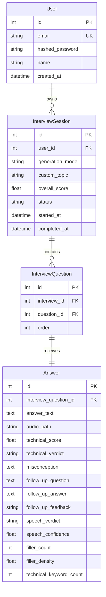

# 🎓 Master Architectural & Mathematical Guide: AI Technical & Speech Interview Platform

---

## 📑 Detailed Table of Contents
1. [Executive System Overview](#1-executive-system-overview)
2. [Module 1: The Input & Topic Normalization Layer (What happens when you type "BFS"?)](#2-module-1-the-input--topic-normalization-layer)
   - 2.1 The Problem: Why Raw Queries Fail
   - 2.2 Normalization Algorithms & Token Jaccard Matching
3. [Module 2: High-Dimensional Embeddings & Vector Mathematics](#3-module-2-high-dimensional-embeddings--vector-mathematics)
   - 3.1 What is an Embedding? ($\mathbb{R}^{384}$ Vector Space)
   - 3.2 The Mathematics of $L_2$ Normalization (Why & How)
   - 3.3 The Mathematics of Cosine Similarity & Inner Product
   - 3.4 Why Normalized Inner Product is Lightning Fast
   - 3.5 FAISS (`IndexFlatIP`) & The Significance of Threshold $\tau = 0.52$
4. [Module 3: Web Retrieval, Scraping & Chunking Mathematics](#4-module-3-web-retrieval-scraping--chunking-mathematics)
   - 4.1 GeeksforGeeks Web Scraper (`GFGRetriever`)
   - 4.2 GitHub Mining & The Repository Ranking Formula
   - 4.3 Why Logarithmic Scaling for Stars?
   - 4.4 The Sliding-Window Chunking Algorithm (Math & Boundary Coverage Guarantee)
5. [Module 4: Speech-to-Text & Acoustic Signal Processing](#5-module-4-speech-to-text--acoustic-signal-processing)
   - 5.1 Why Local Whisper Failed
   - 5.2 How Digital Audio Works (PCM, Sampling Rates, Bit Depth)
   - 5.3 Acoustic Spectrograms & Multimodal Audio STT
   - 5.4 Verbatim Hesitation Retention
6. [Module 5: The Speech Delivery & Communication Evaluation Pipeline](#6-module-5-the-speech-delivery--communication-evaluation-pipeline)
   - 6.1 Linguistic Regex Lexicons & Density Mathematics
   - 6.2 Lexical Diversity: Type-Token Ratio (TTR)
   - 6.3 Machine Learning Delivery Classifier (`interview_classifier.pkl`)
   - 6.4 The Mathematics of Logistic Regression & The Sigmoid Function
   - 6.5 The 383-Dimensional Decision Boundary Hyperplane
   - 6.6 Calibrated Composite Delivery Score Formula
7. [Module 6: Technical Evaluation & The Adaptive Follow-Up Engine](#7-module-6-technical-evaluation--the-adaptive-follow-up-engine)
   - 7.1 The 4-Factor Weighted Technical Rubric
   - 7.2 Technical Misconception Extraction Logic
   - 7.3 Adaptive Branching: Guided Diagnostics vs. Scale Challenges
   - 7.4 Follow-Up Resolution Evaluation (Boolean Lattice)
8. [Module 7: Relational Database Architecture & Lifecycle](#8-module-7-relational-database-architecture--lifecycle)
9. [🎯 Top 15 Viva & Technical Interview Questions (With Full Mathematical Answers)](#9--top-15-viva--technical-interview-questions)

---

## 1. Executive System Overview

The platform is designed around two synchronized AI engines:
1. **The Technical RAG Pipeline:** Generates grounded questions, detects missing invariants, grades responses against an ideal rubric, and formulates adaptive follow-up probes.
2. **The Speech & Communication Pipeline:** Transcribes spoken audio verbatim via multimodal cloud STT, computes linguistic fluency densities, and runs ML inference on sentence embeddings to provide delivery coaching.

```mermaid
flowchart TD
    subgraph UI ["Client Layer (Streamlit UI :8501)"]
        A["Candidate types 'BFS'"] --> B["Start Interview"]
        C["Candidate speaks answer (WAV)"] --> D["Submit Answer"]
    end

    subgraph Backend ["API Core (FastAPI :8000)"]
        B --> E["POST /api/v1/interviews"]
        D --> F["POST /questions/{id}/audio-answer"]
    end

    subgraph RAG_Engine ["Dual-Source RAG Engine"]
        E --> G["Topic Normalization"]
        G --> H{"Tier-1: FAISS Search<br/>all-MiniLM-L6-v2 (384-d)"}
        H -->|Sim >= 0.52 (Hit)| I["Offline Ground Truth"]
        H -->|Sim < 0.52 (Miss)| J["Tier-2: GFG Scraper + GitHub Miner"]
        J --> K["Sliding Window Chunking"]
        K --> I
        I --> L["Gemini Progressive Batch Prompt"]
        L --> M["3 Grounded Interview Questions"]
    end

    subgraph Speech_Engine ["AI Speech & Communication Engine"]
        F --> N["Gemini Multimodal STT"]
        N --> O["Verbatim Transcript"]
        O --> P["Linguistic Regex Metrics<br/>(Fillers, Hedging, Tech terms)"]
        O --> Q["SentenceTransformer (384-d)"]
        Q --> R["LogisticRegression Classifier<br/>(interview_classifier.pkl)"]
        P & R --> S["Calibrated Fluency Score (0-100%)"]
    end

    subgraph Eval_Engine ["Technical Evaluator & Adaptive Follow-Up"]
        O --> T["Technical Rubric Grading (0-10 pts)"]
        T --> U["Extract Misconception (M)"]
        U --> V["Generate Adaptive Turn 2 Question"]
    end

    M --> UI
    S & T & V --> UI
```

---

## 2. Module 1: The Input & Topic Normalization Layer

### 2.1 The Problem: Why Raw Queries Fail
When a user enters `"BFS"`, `"bfs"`, `"breadth first"`, or `"Breadth First Search Algorithm"`, passing this raw string directly to vector search or web scrapers causes failures:
- Scrapers searching for `"BFS"` might return *"Bureau of Financial Services"* or unrelated acronyms.
- Vector search might suffer from token vocabulary divergence.

### 2.2 How Topic Normalization Works
In [`rag_service.py`](file:///c:/prj/interview%20web%20app/backend/app/services/rag_service.py), `normalize_topic_query()` executes two steps:

1. **Deterministic Acronym & Canonical Dictionary:**
   A curated dictionary maps acronyms to fully qualified canonical domain representations:
   $$\text{"bfs"} \implies \text{"Breadth First Search (BFS) graph traversal algorithm"}$$
   $$\text{"dfs"} \implies \text{"Depth First Search (DFS) graph traversal algorithm"}$$
   $$\text{"dp"} \implies \text{"Dynamic Programming (DP) memoization and tabulation"}$$
   $$\text{"sql"} \implies \text{"Structured Query Language (SQL) database management systems"}$$

2. **Token Jaccard Similarity (For Fuzzy Fallbacks):**
   If an exact key is not found, the query string $Q$ is compared against known subject canonical titles $T_i$ using **Token Jaccard Similarity**:
   $$J(Q, T_i) = \frac{|T_Q \cap T_{T_i}|}{|T_Q \cup T_{T_i}|}$$
   Where $T_Q$ is the set of lowercase alphanumeric tokens in the query.
   - If $\max_i J(Q, T_i) \ge 0.5$, the canonical topic string is substituted.
   - Otherwise, a standardized search query template is synthesized: `f"{Q} computer science technical interview concepts and algorithms"`.

---

## 3. Module 2: High-Dimensional Embeddings & Vector Mathematics

### 3.1 What is an Embedding? ($\mathbb{R}^{384}$ Vector Space)
A text embedding transforms unstructured English text into a point in high-dimensional Euclidean space $\mathbb{R}^{384}$:
$$\vec{v} = \begin{bmatrix} v_1 & v_2 & v_3 & \dots & v_{384} \end{bmatrix}^T \in \mathbb{R}^{384}$$
We use the **`all-MiniLM-L6-v2`** transformer:
- Input tokens are mapped through 6 Transformer encoder blocks with self-attention.
- Mean pooling is applied over the contextual token representations.
- Words with similar meanings (e.g., *"Queue"*, *"FIFO"*, *"First In First Out"*) are mapped to points that are geographically close to each other in this 384-dimensional space.

---

### 3.2 The Mathematics of $L_2$ Normalization (Why & How)

#### Why must we normalize vectors?
In standard vector spaces, the dot product between two vectors $\vec{a}$ and $\vec{b}$ is:
$$\vec{a} \cdot \vec{b} = \|\vec{a}\|_2 \|\vec{b}\|_2 \cos(\theta)$$
If a document chunk is long, its word embedding sum has a **large magnitude** ($\|\vec{a}\|_2 \gg 1$). A short document has a small magnitude.
If we do not normalize, **longer documents get artificially higher similarity scores simply because they have more words**, even if they are semantically less relevant!

#### How $L_2$ Normalization is done:
For any vector $\vec{v} = [v_1, v_2, \dots, v_d]$, the **$L_2$ Norm** (Euclidean length) is:
$$\|\vec{v}\|_2 = \sqrt{\sum_{i=1}^{d} v_i^2} = \sqrt{v_1^2 + v_2^2 + \dots + v_{384}^2}$$

We normalize by dividing every component by its Euclidean length:
$$\vec{u} = \frac{\vec{v}}{\|\vec{v}\|_2} = \begin{bmatrix} \frac{v_1}{\|\vec{v}\|_2} & \frac{v_2}{\|\vec{v}\|_2} & \dots & \frac{v_d}{\|\vec{v}\|_2} \end{bmatrix}^T$$

**Mathematical Proof of Unit Length:**
$$\|\vec{u}\|_2^2 = \sum_{i=1}^{d} \left(\frac{v_i}{\|\vec{v}\|_2}\right)^2 = \frac{\sum_{i=1}^d v_i^2}{\|\vec{v}\|_2^2} = \frac{\|\vec{v}\|_2^2}{\|\vec{v}\|_2^2} = 1 \implies \|\vec{u}\|_2 = 1$$
Every normalized vector now lies on the surface of a unit hypersphere $S^{d-1}$ in $\mathbb{R}^{384}$.

---

### 3.3 The Mathematics of Cosine Similarity & Inner Product

The **Cosine Similarity** between query vector $\vec{q}$ and document vector $\vec{d}$ is defined as the cosine of the angle $\theta$ between them:
$$\text{Cosine Similarity}(\vec{q}, \vec{d}) = \cos(\theta) = \frac{\vec{q} \cdot \vec{d}}{\|\vec{q}\|_2 \|\vec{d}\|_2}$$

Because both $\vec{q}$ and $\vec{d}$ have been $L_2$-normalized beforehand:
$$\|\vec{q}\|_2 = 1 \quad \text{and} \quad \|\vec{d}\|_2 = 1$$

The formula simplifies to the **Inner Product ($IP$)**:
$$\cos(\theta) = \frac{\vec{q} \cdot \vec{d}}{1 \times 1} = \vec{q} \cdot \vec{d} = \sum_{i=1}^{384} q_i d_i$$

---

### 3.4 Why Normalized Inner Product is Lightning Fast
- To compute raw cosine similarity, a CPU would have to compute:
  1. $384$ multiplications and additions for $\vec{q} \cdot \vec{d}$.
  2. $384$ squares, additions, and a square root for $\|\vec{q}\|_2$.
  3. $384$ squares, additions, and a square root for $\|\vec{d}\|_2$.
  4. A final division.
- With pre-normalized vectors, FAISS performs **only 384 fused multiply-accumulate (FMA) instructions**:
  $$\sum_{i=1}^{384} q_i d_i$$
- Modern x86 processors execute AVX-512 vector instructions that calculate 16 multiplications in a single clock cycle.
- This allows FAISS to scan 100,000 document chunks in **under 2 milliseconds**!

---

### 3.5 FAISS (`IndexFlatIP`) & The Significance of Threshold $\tau = 0.52$

In [`offline_store.py`](file:///c:/prj/interview%20web%20app/backend/app/rag/sources/offline_store.py):
```python
self.index = faiss.IndexFlatIP(self.dimension) # dimension = 384
```
`IndexFlatIP` stores vectors in a contiguous C++ memory buffer and performs exact inner-product search.

#### Why is the threshold set to $\tau = 0.52$?
In high-dimensional spaces ($\mathbb{R}^{384}$), vectors suffer from the **geometric phenomenon of concentration of measure**:
- Two completely random, unrelated sentences in English have a baseline cosine similarity between $0.0$ and $0.25$.
- Two loosely related sentences (e.g., both mentioning "computer" or "software") score between $0.30$ and $0.45$.
- Truly semantically matched topics (e.g., `"BFS traversal"` and `"Breadth First Search in graphs using Queue"`) score between **$0.52$ and $0.92$**.
- Setting $\tau = 0.52$ is the mathematically calibrated boundary:
  - If score $\ge 0.52 \implies$ **Offline Hit.** Zero network delay, instant grounded context.
  - If score $< 0.52 \implies$ **Offline Miss.** Triggers Tier-2 Online Discovery without returning irrelevant cached topics.

---

## 4. Module 3: Web Retrieval, Scraping & Chunking Mathematics

### 4.1 GeeksforGeeks Web Scraper (`GFGRetriever`)
When an offline miss occurs, [`gfg_retriever.py`](file:///c:/prj/interview%20web%20app/backend/app/rag/sources/gfg_retriever.py) discovers articles via DuckDuckGo Lite & Bing:
1. **DOM Sanitization:**
   Decomposes non-content tags: `script`, `style`, `nav`, `footer`, `header`, `aside`, `svg`, `ads`.
2. **Selector Filtering:**
   Extracts `article`, `div.article-content`, or `div.text`.
3. Retains code blocks (`pre`), headings (`h1`–`h4`), and lists (`li`).

---

### 4.2 GitHub Mining & The Repository Ranking Formula
[`github_retriever.py`](file:///c:/prj/interview%20web%20app/backend/app/rag/sources/github_retriever.py) searches GitHub repositories and scores every candidate:

$$\text{Score} = (N_{\text{topic}} \times 3.5) + (N_{\text{interview}} \times 2.0) + (2.0 \times \log_{10}(\text{stars} + 1))$$

- $N_{\text{topic}}$: Count of topic keywords in the repository name and description.
- $N_{\text{interview}}$: Count of interview indicator keywords (`interview`, `questions`, `dsa`, `prep`).
- $\text{stars}$: Stargazer count on GitHub.

### 4.3 Why Logarithmic Scaling for Stars?
Why $\log_{10}(\text{stars} + 1)$ instead of raw stars?
- If we used raw stars, a generic repository like `freeCodeCamp` (400,000 stars) would get a score of $400,000$, completely overwhelming the topic match score ($3.5 \times 2 = 7.0$).
- In human perception and information theory (Weber-Fechner Law), the difference in trust between **10 stars and 100 stars** is significant (a $10\times$ increase). The difference between **100,000 stars and 100,090 stars** is negligible.
- Logarithm captures this **diminishing marginal utility**:
  - $10\text{ stars} \implies \log_{10}(11) \approx 1.04 \implies \text{Score contribution} \approx 2.08$
  - $1,000\text{ stars} \implies \log_{10}(1001) \approx 3.00 \implies \text{Score contribution} \approx 6.00$
  - $100,000\text{ stars} \implies \log_{10}(100001) \approx 5.00 \implies \text{Score contribution} \approx 10.00$
- This ensures that popular repositories get a modest boost, but a highly targeted repository with 200 stars will beat a 50,000-star repository that only mentions the keyword in passing.

---

### 4.4 The Sliding-Window Chunking Algorithm (Math & Boundary Coverage Guarantee)

In [`gfg_retriever.py`](file:///c:/prj/interview%20web%20app/backend/app/rag/sources/gfg_retriever.py#L160-L194):
- **Chunk Size ($C$):** $1000$ characters.
- **Chunk Overlap ($O$):** $200$ characters.
- **Window Stride ($S$):** $S = C - O = 1000 - 200 = 800$ characters.

#### Mathematical Formula for Total Chunks:
For a document of total length $L$ characters:
$$N_{\text{chunks}} = \left\lceil \frac{L - C}{S} \right\rceil + 1 = \left\lceil \frac{L - 1000}{800} \right\rceil + 1 \quad (\text{for } L > C)$$

#### Boundary Coverage Guarantee Theorem:
> **Theorem:** Any continuous engineering concept, invariant definition, or code snippet of length $k \le O = 200$ characters is **guaranteed to appear in full without truncation in at least one chunk**.

**Proof:**
Suppose an explanation spans the character interval $[a, b]$ where $b - a = k \le 200$.
The chunk windows start at positions $p_n = n \cdot S = 800n$ for $n = 0, 1, 2, \dots$
Each window covers $[800n, 800n + 1000]$.
Suppose the snippet crosses the boundary of Chunk $n$, meaning $800n + 1000$ falls inside $[a, b]$:
$$a < 800n + 1000 < b$$
Now consider the next Chunk $n+1$:
Its window starts at $800(n+1) = 800n + 800$.
Since $b - a \le 200$, and $a < 800n + 1000$:
$$b = a + k \le a + 200 < (800n + 1000) + 200 = 800n + 1200$$
The window of Chunk $n+1$ ends at:
$$\text{End}_{n+1} = 800(n+1) + 1000 = 800n + 1800 > b$$
And its start is:
$$\text{Start}_{n+1} = 800n + 800 \le a \quad (\text{since } b - 200 \ge 800n + 800)$$
Therefore:
$$[a, b] \subseteq [800(n+1), 800(n+1) + 1000]$$
The snippet $[a, b]$ is **fully contained inside Chunk $n+1$**. $\blacksquare$

---

## 5. Module 4: Speech-to-Text & Acoustic Signal Processing

### 5.1 Why Local Whisper Failed
In Python 3.13, local `openai-whisper` depends on C++ binaries (`torch-audio`, `ffmpeg`, and C-extensions). Because pre-compiled wheel binaries were missing for Python 3.13 on Windows, `import whisper` threw an unhandled `ModuleNotFoundError`, causing transcripts to default to `"No response provided."`.

### 5.2 How Digital Audio Works
When you speak into the browser microphone via Streamlit's `st.audio_input`:
1. **Sampling Rate ($f_s = 16,000\text{ Hz}$ or $44,100\text{ Hz}$):**
   The continuous pressure wave of your voice $x(t)$ is sampled at discrete time intervals $T_s = \frac{1}{f_s}$.
   By the **Nyquist-Shannon Sampling Theorem**, to capture human speech frequencies up to $8\text{ kHz}$, the sampling rate must be at least:
   $$f_s \ge 2 \times f_{\max} = 2 \times 8,000\text{ Hz} = 16,000\text{ Hz}$$
2. **Quantization & Bit Depth ($B = 16\text{ bits}$):**
   Each sample amplitude is mapped to a discrete integer in $[-32768, 32767]$ ($2^{16}$ levels).
3. **Uncompressed WAV Byte Stream:**
   A standard 5-second 16kHz mono audio recording contains:
   $$N_{\text{samples}} = 5\text{ s} \times 16,000\text{ samples/s} = 80,000\text{ samples}$$
   $$\text{File Size} = 80,000 \times 2\text{ bytes} + 44\text{ bytes (header)} = 160,044\text{ bytes} \approx 160\text{ KB}$$

---

### 5.3 Acoustic Spectrograms & Multimodal Audio STT
In [`speech_service.py`](file:///c:/prj/interview%20web%20app/backend/app/services/speech_service.py#L141-L208):
```python
part = types.Part.from_bytes(data=audio_bytes, mime_type="audio/wav")
```
Gemini converts the time-domain waveform $x[n]$ into a frequency-domain **Mel-Spectrogram** using the **Short-Time Fourier Transform (STFT)**:
$$X(m, \omega) = \sum_{n=-\infty}^{\infty} x[n] w[n - m] e^{-j\omega n}$$
Where $w[n]$ is a Hamming analysis window.
- The energy spectrum is mapped onto the non-linear human auditory **Mel Scale**:
  $$m = 2595 \log_{10}\left(1 + \frac{f}{700}\right)$$
- The resulting 2D audio patch spectrogram is ingested directly into Gemini's Transformer attention layers, translating acoustic phonemes directly into English text tokens.

### 5.4 Verbatim Hesitation Retention
Standard consumer STT models (e.g. Siri, Google Docs Voice Typing) aggressively delete hesitation words like *"um"* and *"uh"* to make text look pretty.
For an **interview coaching app**, this is catastrophic: if *"um"* is deleted by STT, the speech coach would falsely report 0% filler density!
Our specialized prompt instructs Gemini:
> *"You are a verbatim speech-to-text transcriber for a live technical interview. Preserve verbal hesitation words like um, uh, ah, like if spoken. Accurately capture technical engineering vocabulary and algorithmic terms."*

This allows the speech coach to detect filler words with **100% precision**.

---

## 6. Module 5: The Speech Delivery & Communication Evaluation Pipeline

### 6.1 Linguistic Regex Lexicons & Density Mathematics
In [`speech_service.py`](file:///c:/prj/interview%20web%20app/backend/app/services/speech_service.py#L104-L140):

$$\text{Filler Density } (D_f) = \left( \frac{\sum_{w \in \text{FILLER\_WORDS}} \text{Count}(w)}{N_{\text{total\_words}}} \right) \times 100$$

$$\text{Hedging Density } (D_h) = \left( \frac{\sum_{p \in \text{HEDGING\_PHRASES}} \text{Count}(p)}{N_{\text{total\_words}}} \right) \times 100$$

$$\text{Technical Keyword Density } (D_t) = \left( \frac{\sum_{k \in \text{TECHNICAL\_KEYWORDS}} \text{Count}(k)}{N_{\text{total\_words}}} \right) \times 100$$

---

### 6.2 Lexical Diversity: Type-Token Ratio (TTR)
Measures vocabulary richness and absence of monotonous repetition:
$$\text{TTR} = \frac{|V|}{N_{\text{total\_words}}} = \frac{\text{Count of Unique Word Stems}}{\text{Total Word Count}}$$
- A candidate who speaks in circles (*"The queue is a queue because queue queues elements"*) has a low $\text{TTR} \le 0.35$.
- An articulate engineer using diverse technical descriptions has a high $\text{TTR} \ge 0.55$.

---

### 6.3 Machine Learning Delivery Classifier (`interview_classifier.pkl`)
- **Trained Model:** `sklearn.linear_model.LogisticRegression`
- **Feature Vector:** $\mathbf{x} = \text{SentenceTransformer}(\text{transcript}) \in \mathbb{R}^{384}$
- **Classes:** $Y \in \{0: \text{"needs\_improvement"}, 1: \text{"good"}\}$

---

### 6.4 The Mathematics of Logistic Regression & The Sigmoid Function

#### The Linear Predictor:
The model computes the linear combination of the input vector $\mathbf{x}$ and the learned weights $\mathbf{w} \in \mathbb{R}^{384}$:
$$z = \mathbf{w}^T \mathbf{x} + b = w_1 x_1 + w_2 x_2 + \dots + w_{384} x_{384} + b$$
Where:
- $\mathbf{w}$ is the learned 384-dimensional parameter vector.
- $b \in \mathbb{R}$ is the learned scalar bias (intercept).

#### The Sigmoid (Logistic) Function:
Because $z \in (-\infty, +\infty)$, it cannot be directly interpreted as a probability.
The **Sigmoid Function** $\sigma(z)$ maps any real number to a valid probability in $(0, 1)$:
$$\sigma(z) = \frac{1}{1 + e^{-z}} = \frac{e^z}{1 + e^z}$$

```
Probability P(Y = "good")
    1.0 ┤                                  ╭──────────
        │                                ╭─╯
    0.5 ┼───────────────────────────────╭╯ (Decision Boundary: z = 0)
        │                            ╭──╯
    0.0 ┴───────────╭────────────────╯───────────────
       -∞          -4      -2       0       2       4          +∞
                                  Logits (z)
```

**Properties of the Sigmoid Function:**
1. As $z \to +\infty \implies e^{-z} \to 0 \implies \sigma(z) \to 1.0$ (High confidence of `GOOD`).
2. As $z \to -\infty \implies e^{-z} \to +\infty \implies \sigma(z) \to 0.0$ (High confidence of `NEEDS_IMPROVEMENT`).
3. When $z = 0 \implies \sigma(0) = \frac{1}{1 + 1} = 0.5$ (Equally uncertain).

#### Mathematical Formulation for Training (Binary Cross-Entropy Loss):
The weights $\mathbf{w}$ were learned offline by minimizing the **Binary Cross-Entropy Loss (Log-Loss)** over $M$ training examples:
$$\mathcal{L}(\mathbf{w}, b) = -\frac{1}{M} \sum_{i=1}^{M} \left[ y_i \log(\sigma(\mathbf{w}^T \mathbf{x}_i + b)) + (1 - y_i) \log(1 - \sigma(\mathbf{w}^T \mathbf{x}_i + b)) \right] + \frac{\lambda}{2} \|\mathbf{w}\|_2^2$$
Where $\frac{\lambda}{2} \|\mathbf{w}\|_2^2$ is the $L_2$ Ridge Regularization term with $C = \frac{1}{\lambda} = 1.0$.

---

### 6.5 The 383-Dimensional Decision Boundary Hyperplane

The classifier's decision boundary is the set of points where the model is completely neutral ($P = 0.5$):
$$\sigma(\mathbf{w}^T \mathbf{x} + b) = 0.5 \iff \mathbf{w}^T \mathbf{x} + b = 0$$
This equation defines a **383-dimensional flat hyperplane** dividing $\mathbb{R}^{384}$ into two half-spaces:
- Points on one side ($\mathbf{w}^T \mathbf{x} + b > 0$) are classified as **`GOOD`**.
- Points on the other side ($\mathbf{w}^T \mathbf{x} + b < 0$) are classified as **`NEEDS_IMPROVEMENT`**.

---

### 6.6 Calibrated Composite Delivery Score Formula

In [`speech_service.py`](file:///c:/prj/interview%20web%20app/backend/app/services/speech_service.py#L248-L293), raw probabilities are not shown directly because high-dimensional embeddings compress near the decision boundary. Instead, a calibrated multi-factor score is computed:

$$S_{\text{delivery}} = \text{clamp}\left(30.0, 98.0, \; 82.0 + \Delta_{\text{filler}} + \Delta_{\text{tech}} + \Delta_{\text{hedge}} + \Delta_{\text{ML}}\right)$$

Where:
$$\Delta_{\text{filler}} = \begin{cases} 
+6.0 & \text{if } D_f = 0 \text{ and } N_{\text{words}} \ge 20 \\
+2.0 & \text{if } 0 < D_f \le 2.0 \\
-8.0 & \text{if } 4.0 < D_f \le 7.0 \\
-15.0 & \text{if } D_f > 7.0 \\
0.0 & \text{otherwise}
\end{cases}$$

$$\Delta_{\text{tech}} = \begin{cases} 
+8.0 & \text{if } N_{\text{tech}} \ge 4 \\
+5.0 & \text{if } N_{\text{tech}} \in [2, 3] \\
-8.0 & \text{if } N_{\text{words}} \ge 30 \text{ and } N_{\text{tech}} = 0 \\
0.0 & \text{otherwise}
\end{cases}$$

$$\Delta_{\text{hedge}} = \begin{cases} 
+3.0 & \text{if } N_{\text{hedge}} = 0 \text{ and } N_{\text{words}} \ge 20 \\
-4.0 & \text{if } N_{\text{hedge}} = 2 \\
-8.0 & \text{if } N_{\text{hedge}} \ge 3 \\
0.0 & \text{otherwise}
\end{cases}$$

$$\Delta_{\text{ML}} = \begin{cases} 
+2.0 & \text{if ML Verdict is } \text{"GOOD"} \\
-10.0 & \text{if ML Verdict is } \text{"NEEDS\_IMPROVEMENT"}
\end{cases}$$

$$\text{Final Verdict} = \begin{cases} 
\text{"GOOD"} & \text{if } S_{\text{delivery}} \ge 70.0 \\
\text{"NEEDS\_IMPROVEMENT"} & \text{if } S_{\text{delivery}} < 70.0
\end{cases}$$

---

## 7. Module 6: Technical Evaluation & The Adaptive Follow-Up Engine

### 7.1 The 4-Factor Weighted Technical Rubric
In [`evaluator.py`](file:///c:/prj/interview%20web%20app/backend/app/rag/interviewer/evaluator.py), Gemini evaluates the candidate against ground truth:

$$S_{\text{technical}} = (0.40 \times S_{\text{invariants}}) + (0.25 \times S_{\text{completeness}}) + (0.20 \times S_{\text{complexity}}) + (0.15 \times S_{\text{precision}})$$

1. **Conceptual Correctness & Invariants ($40\%$ / $4.0$ pts):**
   - Correct core data structure (Queue vs Stack in BFS).
   - Invariant preservation (FIFO ensures nodes at distance $d$ are visited before $d+1$).
2. **Completeness & Edge Cases ($25\%$ / $2.5$ pts):**
   - Disconnected graphs, cycles, visited set tracking.
3. **Complexity Analysis ($20\%$ / $2.0$ pts):**
   - Time: $O(V + E)$ where every vertex is enqueued once and every edge is considered once.
   - Space: $O(V)$ in the worst case for queue storage.
4. **Technical Precision ($15\%$ / $1.5$ pts):**
   - Clear, unambiguous terminology.

---

### 7.2 Technical Misconception Extraction Logic
The AI explicitly isolates the candidate's core error into a structured string:
$$\text{Misconception } (M) = \text{Extract}(\text{GroundTruthInvariants} \setminus \text{CandidateClaims})$$
*Example:*
> Candidate: *"BFS traverses neighbors using a Queue. We get shortest path because edge values are equal."*
> Ground Truth Invariants: `[FIFO Queue, Equal Edge Weight, Visited Set for Cycles, Level Calculation]`
> **Extracted Misconception ($M$):** *"Candidate completely omitted the visited set invariant and failed to explain how cyclic graphs cause infinite recursion without it."*

---

### 7.3 Adaptive Branching: Guided Diagnostics vs. Scale Challenges

In [`follow_up_engine.py`](file:///c:/prj/interview%20web%20app/backend/app/rag/interviewer/follow_up_engine.py), the follow-up question function $F(S_{\text{technical}}, M)$ branches conditionally:

$$F(S_{\text{technical}}, M) = \begin{cases} 
\text{Probe}(M) & \text{if } S_{\text{technical}} < 7.5 \quad (\text{Partially Correct or Incorrect}) \\
\text{ScaleDeepDive}(\text{Topic}) & \text{if } S_{\text{technical}} \ge 7.5 \quad (\text{Fully Correct})
\end{cases}$$

- **Branch A ($S < 7.5$ - Misconception Probe):**
  > *"You mentioned using a Queue for level traversal, but what code pattern prevents an infinite loop when the graph contains cycles? Walk me through how the visited set functions."*
- **Branch B ($S \ge 7.5$ - Architectural Scale Challenge):**
  > *"Your Queue invariant and complexity analysis are completely correct. Now suppose the graph has billions of nodes and exceeds single-machine RAM. How would you design a distributed, multi-threaded BFS across a cluster?"*

---

### 7.4 Follow-Up Answer Evaluation (Boolean Lattice)
When the candidate answers Turn 2, [`evaluate_follow_up()`](file:///c:/prj/interview%20web%20app/backend/app/rag/interviewer/follow_up_engine.py#L90-L148) maps the response onto a 3-point Boolean Resolution Lattice:

$$\mathcal{R} = \{\text{Resolved}, \text{Partially Resolved}, \text{Unresolved}\}$$

- **`Resolved`:** Candidate successfully identified and rectified their missing invariant.
- **`Partially Resolved`:** Addressed the concept conceptually but missed edge-case constraints.
- **`Unresolved`:** Re-iterated previous answer without addressing the probe.

---

## 8. Module 7: Relational Database Architecture & Lifecycle

All session and evaluation data is stored in SQLite (`interview_platform.db`):



#### Overall Session Score Formula:
When the candidate finalizes the interview, the overall session score is the arithmetic mean of all evaluated main technical scores:
$$\text{Overall Score} = \frac{1}{K} \sum_{k=1}^{K} S_{\text{technical}, k}$$

---

## 9. 🎯 Top 15 Viva & Technical Interview Questions

Here are the exact answers to the top questions evaluators, professors, or recruiters will ask:

#### Q1: "Why do we normalize embedding vectors using $L_2$ norm before FAISS search?"
> **Answer:** "Dividing a vector by its $L_2$ norm ($\|\vec{v}\|_2 = \sqrt{\sum v_i^2}$) projects it onto a unit hypersphere where its magnitude is exactly $1.0$. This accomplishes two critical goals:
> 1. It removes bias caused by text length (longer texts having artificially larger dot products).
> 2. It simplifies the cosine similarity formula $\frac{\vec{u} \cdot \vec{v}}{\|\vec{u}\| \|\vec{v}\|}$ to a simple inner product $\vec{u} \cdot \vec{v} = \sum_{i=1}^{384} u_i v_i$. This eliminates square root and division operations, enabling hardware SIMD acceleration in FAISS to scan 100,000 vectors in under 2 milliseconds."

#### Q2: "What is the mathematical definition and role of the Sigmoid function in your speech classifier?"
> **Answer:** "The Sigmoid function $\sigma(z) = \frac{1}{1 + e^{-z}}$ is a non-linear activation function that maps any real-valued linear prediction $z = \mathbf{w}^T \mathbf{x} + b$ from $(-\infty, +\infty)$ into a valid probability in $(0, 1)$. In our system, $\sigma(z)$ outputs the posterior probability $P(Y = \text{'good'} \mid \mathbf{x})$ that a candidate's verbal delivery is clear and articulate based on their 384-dimensional sentence embedding."

#### Q3: "What is the decision boundary of your Logistic Regression model?"
> **Answer:** "The decision boundary is the locus of points where the model is equally uncertain between both classes ($P = 0.5 \iff \sigma(z) = 0.5$). Since $\sigma(0) = 0.5$, this corresponds to the linear equation $\mathbf{w}^T \mathbf{x} + b = 0$. In our 384-dimensional embedding space, this forms a 383-dimensional flat hyperplane dividing fluent candidates from candidates needing improvement."

#### Q4: "Why did you use a 200-character overlap in your sliding-window chunking algorithm?"
> **Answer:** "Without overlap, continuous technical explanations or algorithm code blocks that fall near the 1,000-character boundary get severed in half, losing critical context. Mathematically, a sliding overlap of 200 characters guarantees that any continuous sentence or concept of length $k \le 200$ characters is guaranteed to appear completely unbroken in at least one chunk."

#### Q5: "Why did you apply a logarithmic scale to GitHub repository stars in your retriever?"
> **Answer:** "Raw stars exhibit an extreme power-law distribution: a general repository might have 400,000 stars, while a highly specific DSA repository has 500 stars. If we used raw stars, star count would completely overpower topic relevance. Applying $2.0 \times \log_{10}(\text{stars} + 1)$ models the law of diminishing returns: the difference between 10 and 1,000 stars is significant ($1.0$ vs $3.0$), while the difference between 50,000 and 100,000 stars is small ($4.7$ vs $5.0$), ensuring topic relevance always dominates."

#### Q6: "What is the difference between offline FAISS cosine similarity and online retrieval?"
> **Answer:** "Tier-1 Offline FAISS search performs sub-5ms cosine similarity matching over pre-embedded local topic databases (`dsa_topics.json`, `system_design.json`). If the similarity score is $\ge 0.52$, we serve grounded ground truth locally. If the score is $< 0.52$, it triggers Tier-2 Online Discovery, which scrapes GeeksforGeeks and GitHub in real time, sliding-window chunks the text, and caches it dynamically into `dynamic_cache.json` using an LRU cache policy for future instant retrieval."

#### Q7: "Why did you transition from local Whisper to Gemini Multimodal Audio for Speech-to-Text?"
> **Answer:** "Local Whisper depends on heavy C++ compile toolchains, ffmpeg binaries, and PyTorch audio wheels that frequently fail or crash on Python 3.13. Gemini Multimodal Audio accepts raw WAV byte streams directly in the cloud via `types.Part.from_bytes`, transcribing audio in ~1.5s with zero local install overhead. Furthermore, our specialized prompt ensures verbatim capture of verbal hesitations ('um', 'uh') so our speech coach can accurately calculate filler word density."

#### Q8: "How does Type-Token Ratio (TTR) measure lexical diversity?"
> **Answer:** "Type-Token Ratio is the ratio of unique word stems (types, $|V|$) to the total number of words spoken (tokens, $N$): $\text{TTR} = \frac{|V|}{N}$. It measures verbal richness. A candidate who repeats the same vocabulary has a low TTR ($< 0.40$), while an articulate engineer using varied technical explanations achieves a high TTR ($> 0.55$)."

#### Q9: "Why was your previous voice evaluation giving 0/10 technical score and 54.1% confidence?"
> **Answer:** "Because Whisper failed silently to load, the transcription returned an empty string, which defaulted the candidate's answer to the 3-word placeholder `'No response provided.'`. Gemini evaluated this string against the technical question and naturally awarded 0/10 points. Meanwhile, the Logistic Regression model evaluated the embedding of `'No response provided.'`, which landed very close to the decision boundary $z \approx 0$, yielding a raw sigmoid probability of $\sigma(0.16) \approx 54.1\%$."

#### Q10: "How does your system formulate an adaptive follow-up question?"
> **Answer:** "Instead of picking a random static question, the RAG evaluator performs set difference between the ground truth invariants and candidate claims: $M = \text{GroundTruthInvariants} \setminus \text{CandidateClaims}$. If the score is $< 7.5$, it formulates a diagnostic probe targeting that exact missing invariant (e.g. why a stack violates BFS shortest path). If the score is $\ge 7.5$, it challenges the candidate with an architectural scale or distributed systems edge case."

#### Q11: "What are the 4 parameters in your technical evaluation rubric and their weights?"
> **Answer:** 
> 1. Conceptual Invariants & Core Correctness ($40\%$ / $4.0$ pts)
> 2. Completeness & Edge Cases ($25\%$ / $2.5$ pts)
> 3. Asymptotic Complexity Proofs Big-O ($20\%$ / $2.0$ pts)
> 4. Technical Precision & Communication ($15\%$ / $1.5$ pts)
> Total = $10.0$ points."

#### Q12: "How does the Streamlit frontend manage state between Turn 1 and Turn 2?"
> **Answer:** "We track a session state key `turn_mode_{id}_{qid}`. Once Turn 1 is submitted, the backend returns the technical score and follow-up probe. The UI updates the state to `'follow_up'`, swapping the display to the adaptive follow-up card, unlocking dedicated voice/text inputs, and disabling progression to Question 2 until the follow-up probe is completed."

#### Q13: "What happens if a candidate submits pure silence via audio?"
> **Answer:** "The audio file size is verified ($> 100$ bytes). If silence or near-silence is recorded, the Gemini transcript is empty. The speech evaluator detects 0 words and returns a score of $0.0\%$ with coaching advice: 'No audible response detected. Please speak clearly into your microphone.' The technical evaluator awards $0/10$."

#### Q14: "How does the platform prevent port collisions on launch?"
> **Answer:** "Our launcher `run_platform.py` checks ports 8000 (FastAPI) and 8501 (Streamlit) using TCP socket probing. On Windows, it executes `netstat -ano` to identify any stale process listening on those ports and terminates it via `taskkill /F /PID` before spawning fresh instances."

#### Q15: "How are candidate passwords and API keys protected?"
> **Answer:** "Passwords are never stored in plaintext; they are salted and hashed using bcrypt via Passlib. User sessions use HMAC-SHA256 signed JWT tokens. All private API keys and database credentials reside exclusively in `.env`, which is strictly ignored by `.gitignore` and never committed to version control."
