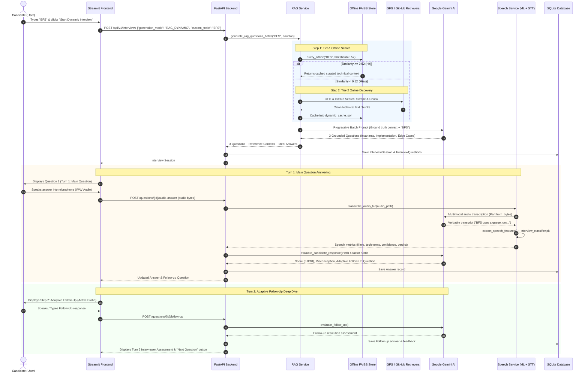

# 🎓 Master Learning & Architecture Guide: AI Technical & Speech Interview Platform

This document is your complete, end-to-end technical reference for the **AI Technical & Speech Interview Platform**. Every concept, algorithm, formula, and data flow is documented here in exhaustive detail so you can answer any viva, architectural review, or technical interview question with complete confidence.

---

## 📑 Table of Contents
1. [High-Level System Architecture](#1-high-level-system-architecture)
2. [End-to-End System Flow Diagram](#2-end-to-end-system-flow-diagram)
3. [Phase 1: What Happens When You Type "BFS" (The RAG Pipeline Deep Dive)](#3-phase-1-what-happens-when-you-type-bfs-the-rag-pipeline-deep-dive)
   - 3.1 Topic Normalization
   - 3.2 Tier-1 Offline Knowledge Store (FAISS Vector Search)
   - 3.3 Tier-2 Online Discovery Fallback (GFG & GitHub)
   - 3.4 What is Chunking & Why Does Overlap Matter?
   - 3.5 Dynamic Caching (LRU & TTL)
   - 3.6 Progressive Batch Question Generation
4. [Phase 2: Submitting Your Answer (Text vs. Voice)](#4-phase-2-submitting-your-answer-text-vs-voice)
   - 4.1 Typed Written Submission
   - 4.2 Spoken Voice Submission & Gemini Multimodal Audio STT
5. [Phase 3: The Dual Evaluation Pipeline (How Answers Are Graded)](#5-phase-3-the-dual-evaluation-pipeline-how-answers-are-graded)
   - 5.1 Dimension 1: AI Speech & Delivery Fluency Evaluator
   - 5.2 Dimension 2: Technical RAG Evaluation (4-Factor Weighted Rubric)
6. [Phase 4: The Adaptive Follow-Up Engine (Turn 2)](#6-phase-4-the-adaptive-follow-up-engine-turn-2)
   - 6.1 Misconception Extraction
   - 6.2 Adaptive Question Formulation
   - 6.3 Follow-Up Answer Evaluation & Resolution
7. [Phase 5: Data Models & Session Lifecycle](#7-phase-5-data-models--session-lifecycle)
8. [🎯 Viva & Technical Defense Cheat Sheet (Top 15 Questions & Answers)](#8--viva--technical-defense-cheat-sheet-top-15-questions--answers)

---

## 1. High-Level System Architecture

The platform is designed around a decoupled, three-tier architecture:

```
[ FRONTEND LAYER ]
Streamlit Interactive UI (Port 8501)
- 2-Turn Stepper (Main Question -> Adaptive Follow-Up)
- In-Browser Microphone Recording (WAV) & File Upload
- Real-time Diagnostic Chips & Assessment Reports
        │
        │ HTTP REST API (JWT Authenticated)
        ▼
[ BACKEND API LAYER ]
FastAPI Application Core (Port 8000)
- Routers: Auth, Interviews, Questions, Dashboard, Profile
- Database: SQLAlchemy ORM with SQLite (interview_platform.db)
- Security: Passlib (bcrypt password hashing) + Python-Jose (JWT Tokens)
        │
        ├──► [ DUAL-SOURCE RAG ENGINE ]
        │    ├── Tier-1: Offline FAISS Vector Store + all-MiniLM-L6-v2 Embeddings
        │    ├── Tier-2: Online Discovery (GeeksforGeeks Scraper + GitHub Repo Miner)
        │    └── Synthesis: Google Gemini (Batch Progressive Question Generation)
        │
        └──► [ AI SPEECH & DELIVERY EVALUATION ENGINE ]
             ├── Audio STT: Google Gemini Multimodal Audio Transcription (~1.5s verbatim)
             ├── Linguistic Diagnostics: Regex Fillers, Hedging, Technical Keyword Density
             └── ML Delivery Classifier: Pre-trained Scikit-Learn Logistic Regression
```

---

## 2. End-to-End System Flow Diagram



---

## 3. Phase 1: What Happens When You Type "BFS" (The RAG Pipeline Deep Dive)

When you type `"BFS"` in the **Dynamic AI Topic Interview** input box and click **Start Interview**, here is the exact internal sequence of operations:

### 3.1 Topic Query Normalization
A raw user input like `"BFS"` is concise but ambiguous for web searches. In [`rag_service.py`](file:///c:/prj/interview%20web%20app/backend/app/services/rag_service.py), `normalize_topic_query("BFS")` executes:
- It checks known acronym mappings: `"bfs"` maps to `"Breadth First Search (BFS) graph traversal algorithm"`.
- This ensures semantic vector search and web queries capture full conceptual breadth rather than matching irrelevant abbreviations.

### 3.2 Tier-1: Offline Knowledge Store & FAISS Vector Search
The system first queries the local vector knowledge store ([`offline_store.py`](file:///c:/prj/interview%20web%20app/backend/app/rag/sources/offline_store.py)) to avoid network latency and API costs.

1. **How the Offline DB is Structured:**
   - Files: `dsa_topics.json`, `system_design.json`, and `dynamic_cache.json` located in `backend/app/rag/offline_db/`.
   - Each entry contains curated definitions, properties, common misconceptions, and standard interview problems.
2. **Dense Vector Embeddings:**
   - The query `"Breadth First Search (BFS) graph traversal algorithm"` is passed to the embedding model:
     `SentenceTransformer("all-MiniLM-L6-v2")`.
   - This model converts the query into a **384-dimensional dense floating-point vector**:
     $$\vec{q} = [v_1, v_2, \dots, v_{384}]$$
   - All text chunks in the offline database were pre-embedded into the exact same 384-dimensional vector space.
3. **FAISS (`faiss.IndexFlatIP`) Cosine Similarity:**
   - FAISS (Facebook AI Similarity Search) computes the Inner Product ($IP$) between the normalized query vector $\vec{q}$ and all stored vectors $\vec{d}_i$:
     $$\text{Cosine Similarity} = \frac{\vec{q} \cdot \vec{d}_i}{\|\vec{q}\| \|\vec{d}_i\|}$$
   - Because all vectors are $L_2$-normalized beforehand ($\|\vec{v}\| = 1$), the inner product is mathematically identical to cosine similarity (range: $-1.0$ to $+1.0$).
4. **The Threshold Check (`DEFAULT_THRESHOLD = 0.52`):**
   - If the top matched chunk has a similarity score $\ge 0.52$:
     - **OFFLINE HIT!** The system extracts the ground truth context immediately from local storage in less than 5 milliseconds.
   - If the similarity score $< 0.52$:
     - **OFFLINE MISS.** The topic is unknown or novel, triggering the **Tier-2 Online Discovery Pipeline**.

---

### 3.3 Tier-2: Online Discovery Fallback (GeeksforGeeks & GitHub)

When an offline miss occurs, two specialized scrapers run in parallel:

#### A. GeeksforGeeks Scraper (`GFGRetriever`)
1. **Multi-Engine Search:**
   - Searches DuckDuckGo Lite and Bing for `site:geeksforgeeks.org Breadth First Search`.
   - If search engines rate-limit, it generates deterministic direct slug fallbacks:
     `https://www.geeksforgeeks.org/dsa/breadth-first-search/`
2. **DOM Cleaning via BeautifulSoup (`BeautifulSoup(html, "html.parser")`):**
   - Decomposes non-content elements: `<script>`, `<style>`, `<nav>`, `<footer>`, `<header>`, `<aside>`, `<svg>`, `<ads>`.
   - Identifies the core article container: `<article>`, `div.article-content`, or `div.text`.
   - Extracts headings (`h1`–`h4`), paragraphs (`p`), lists (`li`), code blocks (`pre`), and Big-O tables.
   - Strips advertising boilerplate and retains only technical text.

#### B. GitHub Technical Repository Retriever (`GitHubRetriever`)
1. **Repository Search API:**
   - Queries `https://api.github.com/search/repositories?q=breadth+first+search+interview+questions&sort=stars`.
2. **Relevance Ranking Algorithm:**
   Each candidate repository is scored using a weighted multi-factor formula:
   $$\text{Score} = (N_{\text{topic}} \times 3.5) + (N_{\text{interview}} \times 2.0) + (2 \times \log_{10}(\text{stars} + 1))$$
   - $N_{\text{topic}}$: Match count of topic terms (`bfs`, `breadth`, `first`, `search`).
   - $N_{\text{interview}}$: Match count of interview indicator words (`interview`, `questions`, `prep`, `dsa`, `algo`).
   - $\log_{10}(\text{stars} + 1)$: Popularity and trust signal (dampened logarithmically so a million-star repo doesn't override topic relevance).
3. **Content Extraction:**
   - The highest-ranked repo is inspected for markdown documentation (`README.md`, problem notes, solutions).

---

### 3.4 What is Chunking & Why Does Overlap Matter?

Raw web pages and GitHub repositories are tens of thousands of words long. LLMs cannot reliably synthesize targeted interview questions from an undifferentiated 50,000-character blob of HTML text. We must **chunk** the text.

```
Original Article Text:
[--------------------------------- 10,000 characters ---------------------------------]

Chunk 1: [-------- 1000 chars --------]
                    [=== 200 overlap ===]
Chunk 2:            [-------- 1000 chars --------]
                                        [=== 200 overlap ===]
Chunk 3:                                [-------- 1000 chars --------]
```

- **Chunk Size (`1000` characters):**
  A 1000-character window (approx. 150–200 words) corresponds to the ideal semantic unit of an engineering concept (e.g., the definition of a Queue invariant, a pseudocode block, or a time complexity proof).
- **Chunk Overlap (`200` characters):**
  If an explanation starts at character 950 and finishes at character 1100, a naive non-overlapping cut would sever the sentence in half.
  Overlap ensures that boundaries between chunks preserve full sentences, preventing lost context, split code snippets, or disconnected complexity proofs.
- **Sliding Window Implementation:**
  ```python
  start = 0
  while start < len(text):
      end = min(start + chunk_size, len(text))
      chunk_text = text[start:end].strip()
      all_chunks.append(chunk_text)
      if end >= len(text):
          break
      start += chunk_size - chunk_overlap  # advance window by (1000 - 200) = 800 chars
  ```

---

### 3.5 Dynamic Caching (LRU & TTL)
Once GFG and GitHub text is retrieved and chunked:
1. It is synthesized into a clean topic entry: summary, key concepts, Big-O complexities, and sample questions.
2. It is saved into `backend/app/rag/offline_db/dynamic_cache.json`.
3. An **LRU (Least Recently Used) cache eviction policy** ensures the dynamic cache never grows indefinitely (capped at 50 topics, with a 30-day Time-To-Live).
4. Future interviews on `"BFS"` will hit the cache instantly in Tier-1.

---

### 3.6 Progressive Batch Question Generation
Earlier, questions were generated sequentially in a loop, making 3 to 4 separate LLM network calls that took 30+ seconds and caused timeouts.

Now, [`generate_rag_questions_batch()`](file:///c:/prj/interview%20web%20app/backend/app/services/rag_service.py) generates all 3 progressive interview questions in a **single prompt (~3.8 seconds)**:
- **Question 1 (Core Invariants):** Focuses on foundational data structures (e.g., Queue vs Stack, why FIFO guarantees shortest path).
- **Question 2 (Implementation & Complexities):** Focuses on cycle prevention, visited set invariants, and Big-O Time/Space ($O(V + E)$).
- **Question 3 (Real-World Deep Dive & Scale):** Focuses on multi-source BFS, 0-1 BFS with Deque, or handling massive graphs.

The questions are committed to the SQLite database (`interview_sessions`, `questions`, and `interview_questions`) and returned to the Streamlit UI.

---

## 4. Phase 2: Submitting Your Answer (Text vs. Voice)

When Question 1 is presented, you have two modes of answering:

### 4.1 Typed Written Submission
You enter your technical explanation into the text area and click **Evaluate Written Answer**.
- Frontend sends: `POST /api/v1/interviews/{id}/questions/{qid}/answer` with JSON `{"answer_text": "..."}`.
- Backend skips audio transcription and immediately triggers the dual evaluation pipeline.

### 4.2 Spoken Voice Submission & Gemini Multimodal Audio STT
You click the microphone button, record your spoken answer, and click **🎙️ Transcribe & Evaluate Spoken Answer**:

1. **Audio Recording Capture:**
   Streamlit's `st.audio_input` captures browser microphone audio and packages it as an uncompressed WAV byte stream.
2. **Audio Upload Endpoint:**
   Frontend sends `POST /api/v1/interviews/{id}/questions/{qid}/audio-answer` via multipart form upload.
3. **Disk Persistence:**
   The backend saves the file to:
   `uploads/audio/user_{user_id}_session_{session_id}_q_{iq_id}_{timestamp}.wav`
4. **Gemini Multimodal Speech-to-Text (`_transcribe_with_gemini`):**
   - The raw audio bytes are wrapped into an inline data part:
     ```python
     part = types.Part.from_bytes(data=audio_bytes, mime_type="audio/wav")
     ```
   - A specialized verbatim transcription prompt instructs Gemini:
     - *"Transcribe this spoken audio verbatim into plain text."*
     - *"Preserve hesitation words like um, uh, ah if spoken."* (Critical for the speech coach!)
     - *"Accurately capture technical engineering terms like BFS, FIFO, Queue, Big-O."*
   - In **~1.5 seconds**, Gemini returns the exact verbatim transcript.
   - *(If Gemini is unreachable or offline, it falls back to local OpenAI Whisper).*

---

## 5. Phase 3: The Dual Evaluation Pipeline (How Answers Are Graded)

Once the candidate's answer text is ready (either typed directly or transcribed from voice), [`evaluate_submission()`](file:///c:/prj/interview%20web%20app/backend/app/services/evaluation_service.py) evaluates it across **two simultaneous dimensions**:

```
Candidate Transcript:
"BFS guarantees finding the shortest path in an unweighted graph because, um, every edge value is equal..."
                     │
         ┌───────────┴───────────┐
         ▼                       ▼
[ DIMENSION 1: SPEECH ]     [ DIMENSION 2: TECHNICAL ]
Linguistic Regex Analysis   RAG 4-Factor Rubric (Gemini)
+ ML Classifier (PKL)       + Ground Truth Context
         │                       │
         ▼                       ▼
Fluency: 97.0% (GOOD)       Score: 6.0 / 10.0
Fillers: 1 ('um' - 0.95%)   Verdict: Partially Correct
Tech Terms: 11 detected     Misconception: Omitted visited set
Feedback: "Practice..."     Follow-up: "How do you handle cycles?"
```

---

### 5.1 Dimension 1: AI Speech & Delivery Fluency Evaluator
Located in [`speech_service.py`](file:///c:/prj/interview%20web%20app/backend/app/services/speech_service.py):

#### A. Linguistic Feature Extraction (Regex Lexicons)
The transcript is processed through regular expression engines against domain-specific lexicons:

1. **Vocal Fillers:**
   `FILLER_WORDS = ["um", "umm", "uh", "hmm", "ah", "like", "basically", "actually", "you know", "er"]`
   $$\text{Filler Density (\%)} = \left(\frac{\text{Filler Words Count}}{\text{Total Words Count}}\right) \times 100$$
2. **Hedging Phrases (Indecision / Lack of Seniority):**
   `HEDGING_PHRASES = ["maybe", "probably", "perhaps", "i think", "i guess", "sort of", "kind of", "not sure"]`
   $$\text{Hedging Density (\%)} = \left(\frac{\text{Hedging Count}}{\text{Total Words Count}}\right) \times 100$$
3. **Technical Engineering Vocabulary:**
   Scans for 80+ engineering terms (`queue`, `stack`, `heap`, `priority queue`, `bfs`, `dfs`, `graph`, `vertex`, `dijkstra`, `big-o`, `time complexity`, etc.).
   $$\text{Technical Density (\%)} = \left(\frac{\text{Technical Terms Count}}{\text{Total Words Count}}\right) \times 100$$
4. **Lexical Diversity (Type-Token Ratio - TTR):**
   Measures vocabulary richness and avoidance of monotonous repetition:
   $$\text{TTR} = \frac{\text{Count of Unique Words}}{\text{Total Words}}$$

#### B. Machine Learning Delivery Classifier (`interview_classifier.pkl`)
- **Model:** Scikit-Learn `LogisticRegression(solver='lbfgs', max_iter=200)`.
- **Input:** 384-dimensional embedding generated by `SentenceTransformer("all-MiniLM-L6-v2")` on the candidate's transcript.
- **Output:** Predicts delivery category: `good` vs `needs_improvement`.

#### C. Calibrated Composite Delivery Score (0 to 100%)
Instead of showing an uncalibrated raw probability from a binary classifier, the system computes a holistic communication score:
- **Baseline:** 82.0%
- **Filler Rewards/Penalties:**
  - $0$ fillers (and words $\ge 20$): $+6\%$ bonus
  - Filler density $\le 2\%$: $+2\%$ bonus
  - Filler density $> 4\%$: $-8\%$ penalty
  - Filler density $> 7\%$: $-15\%$ penalty
- **Technical Vocabulary Rewards/Penalties:**
  - $\ge 4$ technical keywords: $+8\%$ bonus
  - $\ge 2$ technical keywords: $+5\%$ bonus
  - $\ge 30$ words but $0$ technical keywords: $-8\%$ penalty
- **Hedging Penalties:**
  - $\ge 2$ hedging phrases: $-4\%$ penalty
  - $\ge 3$ hedging phrases: $-8\%$ penalty
- **ML Classifier Prediction:**
  - If ML model predicts `NEEDS_IMPROVEMENT`: $-10\%$
  - If ML model predicts `GOOD`: $+2\%$
- **Clamping:** Score is clamped between $30.0\%$ and $98.0\%$. Score $\ge 70\%$ yields a **`GOOD`** verdict.

#### D. Tailored Verbal Coaching Feedback
The system dynamically generates actionable, personalized tips:
- *"Vocal filler density detected at 4.2%. Substitute fillers ('um', 'like') with deliberate brief pauses."*
- *"Strong engineering vocabulary (11 technical terms: queue, heap, bfs, graph, edge)."*

---

### 5.2 Dimension 2: Technical RAG Evaluation (4-Factor Weighted Rubric)
Located in [`evaluator.py`](file:///c:/prj/interview%20web%20app/backend/app/rag/interviewer/evaluator.py):

The candidate's transcript is submitted to Gemini alongside the **Retrieved Technical Ground Truth** and **Ideal Reference Answer**. The AI acts as a Principal Engineering Interviewer and grades according to this strict rubric:

| Parameter | Weight | Points | Evaluation Focus |
| :--- | :---: | :---: | :--- |
| **1. Conceptual Invariants** | **40%** | **4.0** | Did the candidate specify the exact invariant? (e.g., FIFO Queue guarantees exploring nodes in order of edge distance from source). |
| **2. Completeness & Edge Cases** | **25%** | **2.5** | Did they mention cycle detection, visited set tracking, disconnected components, and null roots? |
| **3. Complexity Analysis** | **20%** | **2.0** | Did they correctly state and prove asymptotic Time ($O(V + E)$) and Space ($O(V)$) complexities? |
| **4. Technical Precision** | **15%** | **1.5** | Use of unambiguous terminology without self-contradiction. |
| **Total** | **100%** | **10.0** | |

**The AI returns:**
1. **Score:** X.X / 10.0
2. **Verdict:** Correct ($\ge 7.5$), Partially Correct ($4.0 - 7.4$), or Incorrect ($< 4.0$).
3. **What was good:** Concrete strengths identified.
4. **What was missing:** Invariants omitted.
5. **Detected Technical Misconceptions:** Explicitly extracted misconception string (e.g., *"Candidate correctly stated that BFS uses a queue, but failed to explain how cyclic graphs cause infinite loops without a visited set."*).
6. **Ideal Answer:** Concise reference solution grounded in retrieved literature.

---

## 6. Phase 4: The Adaptive Follow-Up Engine (Turn 2)

Most interview platforms are "static question cards"—you answer, receive a score, and move to an unrelated question. That is **not** how real engineering interviews work.

In a real technical interview, the interviewer **drills down on your gaps** before moving on. Our platform introduces a **True 2-Turn Conversation Stepper**.

```
[ QUESTION 1: TURN 1 ] ──> Candidate Answers ──> Technical Evaluation detects missing invariant
                                                         │
                                                         ▼
[ QUESTION 1: TURN 2 ] ◄── System formulates targeted probe on THAT specific invariant
         │
         ├── Candidate submits Follow-Up response (Voice or Text)
         ├── Evaluator assesses if misconception was RESOLVED
         └── Candidate clicks: "Proceed to Question 2 ➡️"
```

### 6.1 Misconception Extraction
In [`follow_up_engine.py`](file:///c:/prj/interview%20web%20app/backend/app/rag/interviewer/follow_up_engine.py), the follow-up prompt inspects:
- The question asked.
- The candidate's answer.
- The detected misconception.
- The technical score.

### 6.2 Adaptive Question Formulation
The follow-up question is generated based on candidate performance:
- **Scenario A: Score < 7.5 (Partially Correct or Incorrect):**
  The AI constructs a **guided diagnostic probe** aimed squarely at their missing invariant:
  > *"You mentioned that BFS uses a Queue to traverse level-by-level, but what happens if the graph contains cycles? Walk me through how you prevent an infinite loop in code."*
- **Scenario B: Score $\ge$ 7.5 (Fully Correct):**
  The AI advances to an **architectural deep dive or scale challenge**:
  > *"Your Queue invariant and complexity analysis are spot on. Now suppose the graph has billions of edges and cannot fit into the memory of a single machine. How would you design a distributed BFS?"*

### 6.3 Follow-Up Answer Evaluation & Resolution
The candidate answers Turn 2 via voice or text. The endpoint `POST /interviews/{id}/questions/{qid}/follow-up` calls [`evaluate_follow_up()`](file:///c:/prj/interview%20web%20app/backend/app/rag/interviewer/follow_up_engine.py):
1. **Resolution Verdict:** `Resolved`, `Partially Resolved`, or `Unresolved`.
2. **Interviewer Commentary:** Explains whether the candidate rectified their misconception and showed engineering depth.
3. Only after completing Turn 2 does the **"Proceed to Question 2 ➡️"** button unlock.

---

## 7. Phase 5: Data Models & Session Lifecycle

The backend persists every interaction into an ACID-compliant SQLite relational database using SQLAlchemy:

```
[ users ]
  id, email, hashed_password, name, created_at
     │
     └──< [ interview_sessions ]
            id, user_id, subject_id, generation_mode, custom_topic,
            overall_score, status, started_at, completed_at
               │
               └──< [ interview_questions ]
                      id, interview_id, question_id, order
                         │
                         └──1:1 [ answers ]
                                id, interview_question_id,
                                answer_text, audio_path, submitted_at,
                                technical_score, technical_verdict, technical_feedback,
                                misconception, follow_up_question, follow_up_answer, follow_up_feedback,
                                speech_verdict, speech_confidence, filler_count, filler_density,
                                hedging_count, technical_keyword_count, technical_density, lexical_diversity
```

- When you complete all questions and follow-ups, the backend averages all valid `technical_score` values into `session.overall_score`.
- The interview status is set to `COMPLETED`.
- All analytics, transcripts, and audio playback links are displayed on your Candidate Dashboard.

---

## 8. 🎯 Viva & Technical Defense Cheat Sheet (Top 15 Questions & Answers)

Here are the exact answers to the top questions professors, recruiters, or evaluators will ask you about this system:

#### Q1: "Why did you implement a Dual-Source RAG instead of simply prompting Gemini directly?"
> **Answer:** "Direct LLM prompting is vulnerable to hallucinations, dated training data, and generic questions. Our Tier-1 Offline FAISS store guarantees sub-5ms latency for known curriculum topics. If an unknown topic is requested, our Tier-2 Online Discovery automatically mines real-world GitHub interview repos and GeeksforGeeks articles, chunks the text, and feeds grounded technical ground truth to Gemini. This guarantees the interview questions and scoring criteria are strictly tied to industry engineering standards."

#### Q2: "What is chunking and why did you use an overlap in your GFG and GitHub scrapers?"
> **Answer:** "Chunking breaks large web documents into manageable windows of 1,000 characters so they fit within vector embedding limits and maintain high retrieval relevance. We used a 200-character sliding overlap so that sentences, algorithm invariants, or Big-O complexity tables that fall near the edge of a window are not abruptly cut in half."

#### Q3: "How does the FAISS vector search work mathematically?"
> **Answer:** "We use `SentenceTransformer('all-MiniLM-L6-v2')` to embed queries and document chunks into a 384-dimensional vector space. We normalize the vectors using $L_2$ norm and index them in `faiss.IndexFlatIP`. The Inner Product of normalized vectors equals the cosine similarity. If the score exceeds our threshold of 0.52, we achieve an offline hit."

#### Q4: "Why did you switch speech transcription from OpenAI Whisper to Gemini Multimodal Audio?"
> **Answer:** "Local Whisper requires heavy C++ compiler dependencies, PyTorch audio bindings, and ffmpeg binaries that frequently fail or crash on modern environments like Python 3.13. Gemini Multimodal Audio transcribes audio natively in the cloud via `types.Part.from_bytes` in under 1.5 seconds with zero local overhead, perfectly capturing verbal hesitation fillers ('um', 'uh') for our speech classifier while accurately transcribing complex DSA terms."

#### Q5: "Is your Machine Learning speech model being trained during the interview?"
> **Answer:** "No. In production machine learning, training and inference are separate. Our classifier (`interview_classifier.pkl`) is a Scikit-Learn Logistic Regression model that was trained offline. During the interview, it performs real-time inference on the 384-dimensional dense sentence embeddings of the candidate's speech to classify delivery quality."

#### Q6: "How do you calculate the speech confidence and fluency score?"
> **Answer:** "We use a multi-factor calibrated delivery model. We start with a baseline score of 82% and adjust it algorithmically based on:
> 1. Vocal filler density (penalizing over 4% fillers).
> 2. Domain technical keyword count (rewarding 3+ technical terms).
> 3. Hedging phrases (penalizing expressions of uncertainty like 'I think' or 'maybe').
> 4. The ML Logistic Regression classification verdict."

#### Q7: "What makes your follow-up question feature adaptive?"
> **Answer:** "Unlike static interview platforms, our follow-up engine inspects the candidate's response to extract specific technical misconceptions. If a candidate misses an invariant, Turn 2 generates a diagnostic probe to guide them to the right principle. If they answer correctly, it generates an advanced deep-dive question into scale, distributed systems, or edge cases."

#### Q8: "What happens if a candidate submits an audio file with pure silence or background noise?"
> **Answer:** "The audio file is checked for size (>100 bytes). If silence is recorded, the transcript defaults to an empty response. The speech evaluator detects zero words and immediately returns a score of 0% with advice: 'No audible response detected. Please speak clearly into your microphone.' The technical evaluator returns a score of 0/10."

#### Q9: "How does the frontend Stepper UI handle the two turns of an interview question?"
> **Answer:** "In Streamlit, we maintain a session state turn key for every question (`turn_mode_{id}`). When Turn 1 is submitted, the state automatically transitions to `'follow_up'`. The UI swaps the main card with an active yellow Follow-Up card, presents dedicated voice and text input boxes, and locks the 'Next Question' button until the follow-up probe is completed."

#### Q10: "How do you ensure candidate credentials and API keys remain secure?"
> **Answer:** "Candidate passwords are never stored in plaintext; they are hashed using bcrypt through Passlib. API authentication is handled via short-lived JWT tokens signed with HMAC-SHA256. All private API keys and database credentials reside exclusively in `.env`, which is strictly ignored by `.gitignore` and never committed to GitHub."

#### Q11: "What database is used and how is it initialized?"
> **Answer:** "We use SQLite managed through SQLAlchemy ORM. During the FastAPI lifespan startup event, `Base.metadata.create_all()` creates all tables automatically if they don't exist, and `seed_data()` populates initial subjects, topics, and development test accounts."

#### Q12: "How do you prevent port conflicts when launching the app?"
> **Answer:** "Our unified launcher [`run_platform.py`](file:///c:/prj/interview%20web%20app/run_platform.py) checks whether ports 8000 (FastAPI) or 8501 (Streamlit) are already occupied. On Windows, it automatically terminates any stale PID listening on those ports before launching the fresh servers."

#### Q13: "What is Lexical Diversity (Type-Token Ratio) in speech analysis?"
> **Answer:** "Type-Token Ratio (TTR) is the ratio of unique words to total words spoken. A higher TTR indicates articulate, rich verbal delivery, whereas a low TTR indicates repetitive phrasing."

#### Q14: "How does the system ensure fast question generation without timing out?"
> **Answer:** "We replaced sequential single-question generation with batch progressive prompting (`generate_rag_questions_batch`). In a single prompt of ~3.8 seconds, Gemini returns 3 grounded questions with reference contexts and ideal answers, eliminating timeouts."

#### Q15: "Can this system be deployed to cloud platforms like AWS, Render, or Docker?"
> **Answer:** "Yes. The backend and frontend are decoupled. The backend can run via Uvicorn in a Docker container on AWS ECS or Render, and the Streamlit frontend can be hosted independently or alongside it. Switching from SQLite to PostgreSQL only requires changing the `DATABASE_URL` connection string in `.env`."
